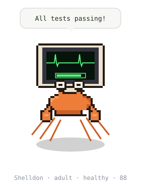

# FitPet 🦀

[](https://github.com/victory-c/fitpet/actions/workflows/ci.yml)

Meet **Shelldon** — a pixel hermit crab whose shell is a CRT terminal — a **desktop companion**
that **grows from your real-world fitness** (via Garmin) and **reacts to your coding** in real
time, a spiritual revival of Claude Code's old `/buddy`. He lives in a small frameless,
transparent, always-on-top window over your editor: he thrives (vivid orange, fast heartbeat)
when you train, greys out and slumps when you rest, and pops a speech bubble + a green/red screen
flash when your tests pass or fail.

<p align="center">
  
</p>

> Honest note: this is an **independent** window you position next to / over Claude Code — it
> reproduces the *feel* of `/buddy`, not its in-app slot (that's Anthropic's).

## Two surfaces, two timescales

Shelldon shows two things at once, composed from modular pixel parts (no per-combination frames):

- **Vitality (short-term ← fitness).** Your Garmin training load over a rolling 7-day window eases
  a 0–100 vitality → **tier** (thriving / healthy / wilting / dormant). It shows redundantly: the
  crab **tints orange→grey** and slumps, the eyes droop, and the **CRT screen is a vitals monitor**
  — a heartbeat whose rate/amplitude/colour track vitality, plus a battery bar. Dormant = the CRT
  goes to **standby**; the next workout reboots him. Fully reversible.
- **Growth (long-term ← fitness, one-way).** Engine-gated on age + healthy days: Shelldon gets
  **bigger** and his **shell hardware** upgrades (egg → chunky mono-CRT → colour monitor → flat
  panel).
- **Reactions (← coding).** Claude Code hooks write quips into state; the window shows a **speech
  bubble** + a brief **green/red screen flash**. Templated, **no model calls**.
- **Coding sessions.** An always-visible label shows estimated session length. After 60 minutes
  without a 15-minute activity gap, Shelldon nudges you to touch grass. This does not affect fitness or growth.
- **Screen debt.** A separate 0–100 score rises during long observed coding sessions and falls
  with breaks, completed workouts, and manually logged outdoor time. Concern-level bubbles are local templates.
- **Sport.** A recent Garmin activity makes Shelldon briefly **perform** it (run / cycle / swim),
  and the CRT shows a sport readout for a while after.

The pet **grows from your workouts** but **reacts to your code**, and the two never affect each other.

## Why the hooks matter

The window runs **outside** Claude Code, so it can't see your coding events itself. Claude Code
hooks (`SessionStart`, `UserPromptSubmit`, `Stop`, `PostToolUse`, `PostToolUseFailure`) are the **bridge**: they
detect events and write reactions into `~/.fitpet/state.json`, which the window watches and shows.

## Requirements

- **Node.js ≥ 23.6** (the engine, CLI, and hooks run TypeScript directly — no build step).
- The desktop window uses **Electron** (installed via `npm install`).
- **Garmin MCP** connected in Claude Code — that's how fitness data reaches the pet.

## Quick start

```bash
git clone <this repo> ~/fitpet && cd ~/fitpet
npm install                              # deps + the Electron binary

node src/cli.ts reset --name Shelldon    # start a fresh egg
npm run app:dev                          # open the companion window

node src/cli.ts install                  # add the coding-event hooks to ~/.claude/settings.json
# → restart Claude Code so the hooks load
```

`install` is safe: it **backs up** your `settings.json`, **merges** (never clobbers existing
keys), and **aborts** rather than overwrite an unparseable file. Preview with
`node src/cli.ts install --print`; undo with `node src/cli.ts uninstall`.

### Coding-session reminders

Existing users: rerun `node src/cli.ts install`, then restart Claude Code and the companion
to enable the new prompt hook. There is no backfill of earlier coding activity.

Hooks append **only event kinds and timestamps** to `~/.fitpet/activity.jsonl` (also covered
by `FITPET_HOME`). No prompts, session identifiers, command text, paths, or output are stored.
The desktop derives one combined timeline from these events; `Stop` is turn completion,
not a break. A gap of **15 minutes or more** ends the session. Reminders appear at **60 minutes**,
last 90 seconds, and fire once per observed session per app run. Restarting while overdue
may show one again. Tune defaults in `src/config.ts`.

### Snooze and nudge intensity

Right-click Shelldon, a speech bubble, or a label for **Snooze 30 min / 1 hour / until
tomorrow / Unsnooze** and **Nag intensity → Gentle / Normal / Persistent**. Move the
window using the small drag strip above the bubble. While snoozed, an always-visible
**Nudges snoozed** badge shows remaining minutes; hover for the expiry date/time.

```bash
node src/cli.ts snooze 30
node src/cli.ts snooze 2h
node src/cli.ts snooze tomorrow
node src/cli.ts snooze off
node src/cli.ts nag gentle
node src/cli.ts status
```

| Intensity | First session nudge | Repeats in an active session | Debt bands that can bubble |
| --- | --- | --- | --- |
| gentle | 90 minutes | Never | 60 / 80 |
| normal (default) | 60 minutes | Never | 35 / 60 / 80 |
| persistent | 45 minutes | Every 30 minutes after the previous opportunity | 35 / 60 / 80 |

Concern messages never repeat within a stable band: they appear on an initial eligible
band or escalation. All levels retain the recovery-to-normal message. Personality only
changes tone. Reminders last 90 seconds, and their per-session history resets on app restart.
Changing intensity does not reset that history or replay debt transitions. Missed repeat
intervals never queue a burst.

Snooze hides touch-grass and **all** debt bubbles (including recovery), not ordinary
edit/test/fitness reactions. Already-visible nudges are dismissed; suppressed opportunities
are consumed, not replayed on Unsnooze. Normal/gentle therefore wait for a new session if
their one reminder occurred while snoozed; persistent waits for its next interval.
**Debt continues accruing and recovering unchanged**, and its score remains visible.

Positive whole durations accept minutes (bare or `m`) and hours (`h`). A new snooze replaces
the previous one. `tomorrow` means the **next local calendar midnight**, not 24 hours;
daylight-saving changes are respected when resolving it. Settings persist in `state.json`
with backward-compatible defaults; old pets retain identity and growth.
Settings also retain a presentation-only dismissal timestamp so a muted persisted nudge
cannot reappear after Unsnooze or an app restart; ordinary reactions are unaffected.

Expiry is an absolute timestamp checked on every snapshot/status, including after sleep
or restart. Later timezone changes do not move it. Moving the system clock forward may
expire snooze early; moving it backward extends the remaining time and can reactivate a
retained deadline. Expired timestamps do not require a background write. The CLI status
shows intensity, remaining minutes, and the local expiry including timezone.

This estimates **hook-observed activity**, not actual screen time: manual coding can be missed,
and autonomous tools can count while you are away. Silence does not prove you went outside.
The reader caches unchanged logs and reads only the last 2 MiB; older history can be omitted.
The on-disk journal is not automatically rotated yet. With the companion stopped and hooks
inactive, you can delete the journal to clear activity history without resetting the pet.

### Screen debt and recovery

Debt is replayed chronologically over the last **7 days**, starting when debt tracking is first
saved for your pet. The displayed score is derived, not a per-poll counter. Settings in `src/config.ts`:

- First 30 minutes of each observed session: no debt.
- Minutes 30–60: 0.25 points/minute; after 60: 0.5 points/minute.
- Coding estimates include at most one minute after the final event, not the whole idle gap.
- After a 15-minute activity gap, inferred break recovery is 0.5 points/minute, capped at 15 points per break.
- Completed workouts and outdoor entries repay 1 point/minute, capped at 40 per entry. No negative credit bank.
- Concern bands start at 35, 60, and 80. These are product defaults, **not medical guidance**.

Garmin activity durations supply workout credit; rolling training load by itself does not.
Credit applies at the activity's completion time, so an old workout discovered later cannot
prepay coding that happened afterward. Repeated syncs deduplicate source activity IDs (with a
start-time/sport fallback); edited workouts keep their original credit. Gym workouts count as
workouts, not proof of outdoor time. A newly started/incomplete workout is not credited yet.

Log outdoor time ending now with `node src/cli.ts outdoor 20` (up to 180 minutes per entry).
This is self-reported and does not change vitality or growth. Avoid logging an outing already
credited as a Garmin workout: cross-source/manual overlap cannot be reliably detected.
`fitpet feed` remains a synthetic fitness testing command, not a completed workout recorder.

Recovery records (hashed identities, completion timestamps, minutes, and kind) are stored in
`~/.fitpet/state.json`; the hook journal remains **only kinds and timestamps**. Missing older
schema fields migrate without resetting identity or growth. The replay uses only available journal
history (last 2 MiB), so deleting/truncating the journal or changing scoring settings can change debt.
Recovery history is bounded to 2,048 entries and the rolling window; this is a wellness toy, not an audit ledger.

CLI, hook, and desktop settings transactions cooperate through `~/.fitpet/state.lock`. They wait up to
two seconds, recover confirmed dead-process owners, and fail closed for uncertain locks.
An interrupted empty/malformed lock or orphaned `.recover` guard may need manual removal **only
after stopping all FitPet writers**. Desktop reads remain non-writing. External scripts that call
the low-level `saveState` directly must use the same transaction lock.

### Cline activity (opt-in, project-local)

FitPet accepts both Cline VS Code and CLI hook envelopes. Choose your host explicitly:

```bash
# Preview only: no hooks or settings are changed.
node /Users/victorchun/fitpet/src/cli.ts cline-install --host vscode --workspace /Users/victorchun/fitpet --print

# Install for Cline VS Code in this workspace (then enable Hooks in Cline settings).
node /Users/victorchun/fitpet/src/cli.ts cline-install --host vscode --workspace /Users/victorchun/fitpet

# Or use --host cli for the Terminal/CLI host, not both for the same host.
# Remove unchanged FitPet launchers; pet state and activity history remain intact.
node /Users/victorchun/fitpet/src/cli.ts cline-uninstall --host vscode --workspace /Users/victorchun/fitpet
```

The VS Code installer writes six executable, extensionless files under the selected workspace's
`.clinerules/hooks`: TaskStart, UserPromptSubmit, PreToolUse, PostToolUse, TaskComplete, TaskCancel.
The CLI installer writes `.cline/hooks/<Event>.sh` for those events plus TaskResume, TaskError,
and SessionShutdown. Restart/reload Cline after installing; actual hook availability depends on
your host/version. PreCompact and Notification are deliberately not installed.

Installation requires an explicit absolute existing workspace, supports POSIX `/bin/sh` only,
and never changes global settings or enables hooks. It refuses existing foreign/edited hook
files, alternate event filenames, and symlinked destinations rather than overwriting/wrapping
them. Uninstall removes only exact matching generated launchers. If Node or the FitPet repo
moves, uninstall with the original environment before reinstalling; the launchers contain
absolute paths to avoid relying on the editor's Node PATH. Do not commit machine-specific launchers.

The adapter always returns `{"cancel":false}`, injects no model context, and prints no private
payload or diagnostics. It appends **only `{t, kind}`** using the local reception timestamp:
start/resume → session_start, prompt → prompt, tool start → tool, tool completion → tool/edit/error,
and completion/cancel/shutdown → stop. Task errors → error. Tool success does not imply a test
passed; commands and output are not inspected for test classification. Task completion is not a
break. No Cline user/task IDs, source labels, paths, prompts, or output enter the journal.

Claude Code and Cline share the same timeline and debt calculation. Simultaneous events do not
double elapsed time, though autonomous tools can still look like human activity. If using a
custom `FITPET_HOME`, make sure Cline inherits it and the companion uses the same value.
No installed Cline binary/extension was available for live host validation during development;
the real generated launchers are tested with documented extension and CLI fixture payloads.
See `docs/cline-hooks.md` for the upstream contracts used.

> If `npm run app:dev` fails with `Error: Electron uninstall`, the Electron binary didn't
> download. Fix it with `node node_modules/electron/install.js`, then retry.

## How growth works

A hook can't call an MCP tool, so fitness data is pulled by a model-run sync:

- **Automatic-ish:** when the pet's data is stale (> 8h), a `SessionStart` hook nudges Claude to
  run the sync at the start of a session.
- **Manual:** run the **`/fitpet-sync`** skill any time — it reads your recent Garmin activity +
  training load and feeds the pet.

Decay is **data-driven**: the pet only wilts when a sync shows you actually trained less — never
because you forgot to sync.

## Commands

| Command | What it does |
| --- | --- |
| `npm run app:dev` | Launch the companion window (dev) |
| `fitpet status` | Print the pet as text (debug; the window is the real face) |
| `fitpet feed <minutes>` | Hand-feed a synthetic workout (for testing) |
| `fitpet sync --source garmin --file <json>` | Apply Garmin MCP data (the `/fitpet-sync` skill does this) |
| `fitpet react <event>` | Force a quip (`test_pass`, `error`, …) — pops the bubble |
| `fitpet reset [--name --species --personality]` | Start a fresh pet |
| `fitpet install [--print --repair]` / `uninstall` / `doctor` | Manage the Claude Code hooks |

(Run via `node src/cli.ts <command>` unless you've linked the `fitpet` bin.) The window and the
CLI/hooks share `~/.fitpet` — set `FITPET_HOME` on both to use a throwaway pet for testing.

## How it's built

Four decoupled pieces share one local file, `~/.fitpet/state.json`, and never call each other:

1. **The window** — [`src/desktop/`](src/desktop): an Electron app. `main.ts` reuses the engine
   and watches state; `renderer/` draws the pixel sprite, speech bubble, and animations.
2. **The heartbeat + reactions** — [`src/hooks/`](src/hooks): the coding-event bridge.
3. **The feeder** — the [`/fitpet-sync`](skills/fitpet-sync/SKILL.md) skill + `fitpet sync` (Garmin).
4. **The content** — [`src/content/`](src/content): species, personalities, and the quip library.

All the rules live in pure, unit-tested functions ([`src/vitality.ts`](src/vitality.ts),
[`src/engine.ts`](src/engine.ts)). The sprites are **original programmatic pixel art** —
editable text grids in [`src/desktop/renderer/sprites/`](src/desktop/renderer/sprites) (a
character per pixel). Run the tests with `npm test`, types with `npm run typecheck`, and build
the app with `npm run app:build`.

## Tuning

Sim balance lives in [`src/config.ts`](src/config.ts): tier cutoffs, ease rate, evolution
requirements, sport-intensity factors, and `GARMIN_LOAD_GOAL`. Animation timings live in the
window's [`index.html`](src/desktop/renderer/index.html).

## Roadmap

- Art polish: per-stage body proportions (the current build scales one body), more shell decals/stickers.
- **Optional model-generated speech bubbles** (the original `/buddy` used live commentary) — V1
  stays templated/local; this would be opt-in.
- **Background growth without a session:** an HTTP/OAuth source (e.g. **WHOOP**) polled by a
  cron, so the pet grows with no model involvement. The feeder is a one-file adapter
  ([`src/sources/`](src/sources)).
- Packaging the window as a standalone app (electron-builder) with launch-at-login.

## Privacy

Single-player and fully local. FitPet's scoring and storage are plain arithmetic on **your own**
data, kept on your machine — **nothing is sent to any third party or used for training.**

One honest caveat: to read Garmin, the `/fitpet-sync` skill has **the model** call the Garmin MCP,
so your activity data passes through the model's session (as it must, to be fetched). The payload
is handed to FitPet via a temp file, never via command-line args. A truly model-free path (the
WHOOP background adapter above) is on the roadmap.

## License

MIT — see [LICENSE](LICENSE).
